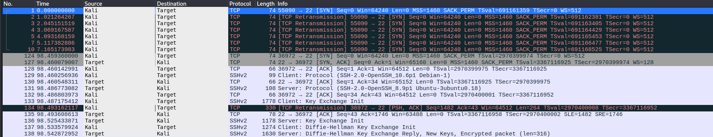
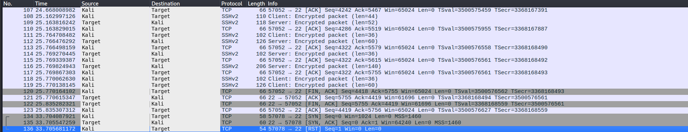

# Week 02 · How a network works: OSI and TCP/IP on my lab network

Sprint 1 · 9–18 Nov 2026 · Matching TEK-UP course: Réseaux IP-1

## Goal

See the OSI layers in real traffic: open an SSH connection from Kali to a Target VM, capture it in Wireshark, and name what each layer does in the packets.

## What I learned (3 sentences, notes closed)

1. OSI is a 7-layer reference model that standardizes how data moves across a network and helps me troubleshoot it layer by layer: Layer 2 moves frames on the local network with MAC addresses, Layer 3 routes packets between networks with IP addresses, Layer 4 carries data end to end with TCP or UDP ports, and Layer 7 is the application, here SSH.
2. In the first SYN from Kali to the Target, Kali is the source at every layer: Kali's MAC to the Target's MAC, Kali's IP to the Target's IP, and a random high port on Kali to port 22 on the Target.
3. The SSH version banners, the algorithm lists and the Diffie-Hellman key exchange are in cleartext, and everything after them is encrypted; an Nmap SYN scan ends with an RST because the SYN-ACK already proves the port is open, so the scanner resets instead of finishing the handshake.

## What I built

A two-VM lab on a host-only network (VMnet1): Kali as the analyst machine and an Ubuntu 22.04 Target with an SSH server. Kali has a second network card on NAT for updates; the Target has no internet.

```bash
# Target (Ubuntu): SSH server
sudo apt install openssh-server
sudo systemctl status ssh

# Kali: check the VMnet1 interface and reach the Target
ip a
ping -c 4 <target>

# Kali: capture on the VMnet1 interface (eth1), then connect
sudo wireshark            # start a capture on eth1
ssh <user>@<target>       # log in, then exit

# Kali: a SYN scan of port 22, captured the same way
sudo nmap -sS -p 22 <target>
```

What each layer showed in the first SYN of the SSH connection:

| Layer | What I saw in Wireshark |
| --- | --- |
| 2 · Data link | Ethernet II: source = Kali's MAC, destination = the Target's MAC |
| 3 · Network | IPv4: source = Kali, destination = the Target |
| 4 · Transport | TCP: random high source port on Kali, destination port 22, SYN flag |
| 7 · Application | SSH: version banners in cleartext, then key exchange, then encrypted data |

The full connection in the capture: SYN, SYN-ACK, ACK; both version banners; algorithm negotiation and the Diffie-Hellman key exchange; encrypted packets; then FIN, ACK at the end.

The Nmap scan looked different from a normal connection. The SSH client's SYN had a window of 64240 and four options (MSS, SACK_PERM, timestamps, window scale). Nmap's SYN had a window of 1024 and only the MSS option. The Target answered SYN-ACK, and Kali sent RST instead of ACK. A SYN with a tiny window and almost no options is one way to spot a scanner in a capture.

## What broke and how I fixed it

My first SSH attempt failed. Kali sent the SYN 7 times in 7 seconds (the first one and 6 retransmissions) and got no answer at all: no SYN-ACK and no RST. No answer is different from a closed port: a closed port 22 would have answered with an RST, so the packets were not reaching a working Target. I checked that the Target's IP address was right and tried again, and the second attempt completed the handshake.

## Proof

The failed attempt (SYN retransmissions), then the handshake, the version banners and the key exchange (Wireshark filter `tcp.port == 22`; addresses replaced with Kali and Target):



The end of the SSH session (FIN, ACK both ways), then the Nmap SYN scan: SYN, SYN-ACK, RST:



The capture file stays on my lab machine; it isn't in this repo.

## Next

IP addressing and subnetting (23–24 Nov): VMs on different subnets, proving what can reach what, and a DNS lookup capture.

## Privacy check (before every commit and post)

- [x] No real IP addresses, hostnames or usernames
- [x] No passwords, keys or tokens
- [x] No school or employer data
- [x] Screenshots cropped to what matters
- [x] gitleaks passed on commit
